# Logistics ERD (테이블 관계)

GitHub 등 Mermaid 를 지원하는 곳에서 보면 그림으로 보인다.

```mermaid
erDiagram
    users ||--o{ user_addresses : "배송지"
    users ||--o{ cart_items : "장바구니"
    users ||--o{ orders : "주문"

    categories ||--o{ products : ""
    products ||--o{ inventories : "센터별 재고"
    warehouses ||--o{ inventories : ""
    products ||--o{ cart_items : ""
    users ||--o{ restock_alerts : "재입고 알림"
    products ||--o{ restock_alerts : ""

    orders ||--|{ order_items : "주문 상품"
    products ||--o{ order_items : ""
    warehouses ||--o{ order_items : "출고 센터"
    orders ||--o{ order_status_history : "상태 이력"
    orders ||--|| payments : "결제/환불"
    orders ||--o| returns : "회수"
    orders ||--|| shipments : "배송"
    warehouses ||--o{ shipments : "대표 출고 센터"
    shipments ||--o{ shipment_events : "배송 이력"

    users {
        bigint id PK
        varchar email UK
        varchar password "BCrypt"
        varchar name
        varchar phone
        varchar role "USER | ADMIN"
        timestamp created_at
    }
    user_addresses {
        bigint id PK
        bigint user_id FK
        varchar label
        varchar receiver_name
        varchar receiver_phone
        varchar address
        boolean is_default "회원마다 1개"
    }
    categories {
        bigint id PK
        varchar name
    }
    products {
        bigint id PK
        bigint category_id FK
        varchar name
        varchar description
        int price
        varchar option_name
        varchar image_url
        timestamp created_at
    }
    warehouses {
        bigint id PK
        varchar name
        varchar region "SEOUL | GYEONGGI | BUSAN"
        varchar address
        boolean same_day_shipping
        timestamp created_at
    }
    inventories {
        bigint id PK
        bigint product_id FK "UK(product_id, warehouse_id)"
        bigint warehouse_id FK
        int quantity "실물 재고"
        int reserved_quantity "주문됐지만 출고 전"
        timestamp updated_at
    }
    cart_items {
        bigint id PK
        bigint user_id FK "UK(user_id, product_id)"
        bigint product_id FK
        int quantity
        timestamp created_at
    }
    restock_alerts {
        bigint id PK
        bigint user_id FK "UK(user_id, product_id)"
        bigint product_id FK
        timestamp created_at
    }
    orders {
        bigint id PK
        bigint user_id FK
        varchar status "ORDERED ~ RETURNED"
        varchar payment_method "CARD | BANK_TRANSFER"
        int product_total
        int shipping_fee
        int total_price
        varchar receiver_name "주문 시점 복사"
        varchar receiver_phone "주문 시점 복사"
        varchar address "주문 시점 복사"
        bigint version "낙관적 락 @Version"
        timestamp created_at
    }
    order_items {
        bigint id PK
        bigint order_id FK
        bigint product_id FK
        bigint warehouse_id FK "출고 센터"
        int quantity
        int price "주문 당시 가격"
    }
    order_status_history {
        bigint id PK
        bigint order_id FK
        varchar from_status "생성 시 null"
        varchar to_status
        bigint changed_by "회원 id, 시스템이면 null"
        timestamp changed_at
    }
    payments {
        bigint id PK
        bigint order_id FK "UK"
        varchar method
        int amount
        varchar status "PAID | REFUNDED"
        timestamp paid_at
        timestamp refunded_at
        varchar refund_reason
    }
    returns {
        bigint id PK
        bigint order_id FK "UK"
        varchar status "REQUESTED | COMPLETED"
        varchar reason
        timestamp requested_at
        timestamp completed_at
    }
    shipments {
        bigint id PK
        bigint order_id FK "UK"
        bigint warehouse_id FK
        varchar courier
        varchar tracking_number "출고 시 발급"
        varchar status "PREPARING ~ RETURNED"
        timestamp shipped_at
        timestamp in_transit_at
        timestamp delivered_at
    }
    shipment_events {
        bigint id PK
        bigint shipment_id FK
        varchar status
        varchar location
        varchar message
        timestamp occurred_at
    }
```

## 테이블 설명

| 테이블 | 역할 | 비고 |
|---|---|---|
| `users` | 회원 | `email` 유니크, 비밀번호는 BCrypt 해시 |
| `user_addresses` | 회원 배송지 | 회원당 기본 배송지 1개 |
| `categories`, `products` | 상품 | `image_url`: 관리자가 올린 사진이면 `/uploads/products/...` (파일은 `backend/uploads/`) |
| `warehouses` | 물류센터 | 서울·경기·부산 |
| `inventories` | 센터별 재고 | `(product_id, warehouse_id)` 유니크. 판매가능재고 = `quantity - reserved_quantity` |
| `cart_items` | 장바구니 | `(user_id, product_id)` 유니크 |
| `restock_alerts` | 재입고 알림 신청 | `(user_id, product_id)` 유니크. 상품 삭제 시 함께 삭제 |
| `orders` | 주문 | 배송지는 주문 시점 값을 복사. `version` 으로 동시 수정 충돌 감지 |
| `order_items` | 주문 상품 | 상품마다 출고 센터(`warehouse_id`)를 저장 |
| `order_status_history` | 상태 변경 이력 | 누가 언제 무엇에서 무엇으로 |
| `payments` | 모의 결제·환불 | 주문 즉시 PAID, 취소/회수완료 시 REFUNDED |
| `returns` | 회수 | 출고 후 취소 시 생성 |
| `shipments` | 배송 | 주문 1건에 1개, 주문과 함께 생성 |
| `shipment_events` | 배송 타임라인 | 주문 상태가 바뀔 때마다 자동으로 한 줄 |

## 재고가 움직이는 시점

| 사건 | `quantity` (실물) | `reserved_quantity` (예약) | 방식 |
|---|---|---|---|
| 주문 | 그대로 | `+ n` (판매가능재고 ≥ n 일 때만) | 조건부 UPDATE 한 줄 (원자적) |
| 출고 전 취소 | 그대로 | `- n` | 조건부 UPDATE |
| 출고 (SHIPPED) | `- n` | `- n` | 조건부 UPDATE |
| 회수 완료 (RETURNED) | `+ n` | 그대로 | UPDATE |
| 관리자 재고 조정 | 지정한 값 (예약보다 작게는 불가) | 그대로 | `SELECT ... FOR UPDATE` (비관적 락) |
